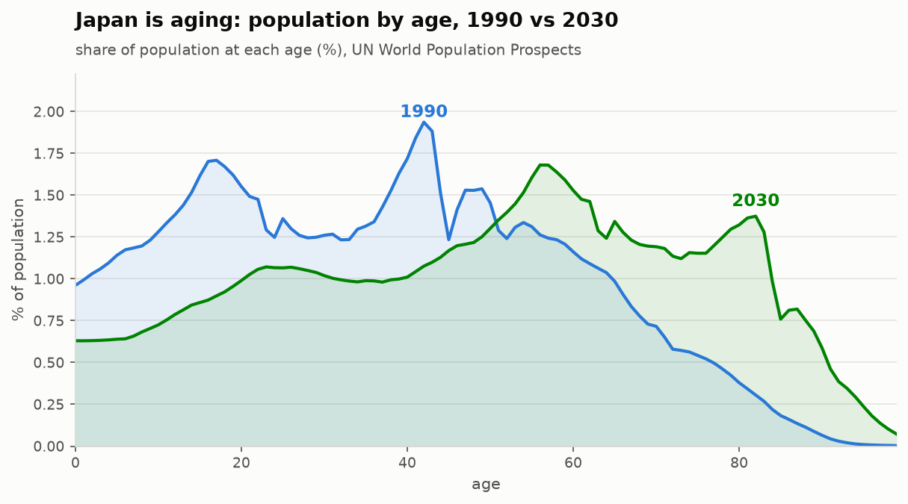

# OG-Japan (OG-JPN)

An overlapping-generations model of Japanese fiscal policy, built on
[OG-Core](https://github.com/PSLmodels/OG-Core). OG-JPN is a country
calibration of OG-Core, in the same family as OG-USA, OG-UK, OG-BRA, and
OG-THA. To our knowledge it is the first open-source OG model of Japan.

Japan is an unusually important case for this class of model: it has the
oldest population of any large economy and a gross public debt of roughly
215 percent of GDP, beyond what OG-Core's default parameter range even
anticipated. Those are exactly the fiscal-demographic dynamics
overlapping-generations models are built to study.



## What it does

The model is calibrated to real Japanese data and solved end to end:

- **Demographics** are live UN World Population Prospects data (country
  code 392): fertility, mortality, and the population by age.
- **The fiscal and tax side** is grounded in published figures: gross debt
  215 percent of GDP (IMF), the capital share from the Penn World Table,
  income, social-insurance, capital, corporate, and the 10 percent
  consumption tax from national sources.
- The model solves a **steady state** and a full **transition path** (the
  economy's year-by-year journey as the population ages).

Solved on Japan's actual age structure, the steady state reproduces the
quantity nobody told it: fed only the demographics, it returns a public
pension burden of about 11 to 12 percent of GDP, close to Japan's actual
figure. See **[docs/METHODOLOGY.md](docs/METHODOLOGY.md)** for the full,
honest validation (what matches, what is still first-pass, and why).

## Policy results

Three fiscal reforms Japan is actually debating, each solved both as a
long-run steady-state comparison and on the transition path, on real
Japanese demographics:

| Reform | Long-run effect |
|---|---|
| [Consumption tax 10 to 15 percent](docs/results_consumption_tax.md) | revenue up about 1.5 points of GDP per two-point rise |
| [Pension age 65 to 70](docs/results_retirement_age.md) | pension bill from 11.4 to 9.5 percent of GDP, labor up |
| [Replacement-rate cut 10 and 20 percent](docs/results_replacement_rate.md) | pension bill from 11.4 to 9.1 percent, labor up |


The transition versions (the `*_tpi.md` docs) add what a steady-state
comparison cannot: the year-by-year path and the net present value of the
change. Across all three, one result is consistent and was invisible to the
steady-state comparison alone: **capital builds up over the horizon**, as
each reform tilts households toward saving. That is the kind of thing the
dynamics are there to show.

## Contributions upstream

Building OG-JPN surfaced improvements to OG-Core itself, contributed back:

- **npv_table** ([PR #1195](https://github.com/PSLmodels/OG-Core/pull/1195),
  approved): a table of the net present value of a reform's flow-variable
  changes, which OG-JPN uses to report the transition results.
- **Custom initial wealth distribution**
  ([PR #1209](https://github.com/PSLmodels/OG-Core/pull/1209)): a hook for a
  country model to supply an observed initial wealth distribution instead of
  the steady-state one (see Limitations).
- **Resource-constraint failure diagnostics**
  ([PR #1213](https://github.com/PSLmodels/OG-Core/pull/1213)): the transition
  solver now reports the size and location of a resource-constraint failure
  so a boundary artifact can be told from a real calibration problem.

## Honest limitations

- The income tax uses a single average effective rate rather than Japan's
  full progressive schedule; sharpening it needs the income distribution
  behind the published rates.
- The transition satisfies the resource constraint to about 1e-7 at every
  period except the second, where a small localized artifact survives. It is
  an initial-condition effect (OG-Core seeds the path from the terminal
  steady state's wealth profile, a poor match for Japan's demographic shift),
  it does not propagate, and it cancels in every reform-minus-baseline
  result. PR #1209 above is the upstream half of closing it; the remaining
  half is feeding it Japan's observed wealth-by-age data.
- The income anchor (`mean_income_data`) is still OG-Core's US default, so
  currency-denominated output is not yet in yen (see docs/NEXT_STEPS.md).

## Layout

```
ogjpn/
  calibrate.py     assembles macro + tax + demographics into OG-Core
  macro_params.py  debt, growth, capital share, spending shares (sourced)
  tax_params.py    income, payroll, capital, corporate, consumption taxes
  constants.py     country code (392) and metadata
examples/
  run_ogjpn_ss.py               solve and validate the steady state
  run_ogjpn_tpi.py              solve the baseline transition path
  analysis_consumption_tax.py   / _tpi.py   consumption-tax reform
  analysis_retirement_age.py    / _tpi.py   pension-age reform
  analysis_replacement_rate.py  / _tpi.py   replacement-rate reform
docs/
  METHODOLOGY.md   how it is built, data sources, validation
  NEXT_STEPS.md    what remains and how to do it
  results_*.md     the policy write-ups
```

## Running

With OG-Core installed in the environment and a free UN Data Portal API
token saved as `un_api_token.txt` in the run directory:

```
PYTHONPATH=. python examples/run_ogjpn_ss.py    # steady state + validation
PYTHONPATH=. python examples/run_ogjpn_tpi.py   # baseline transition
```

Without a token, OG-Core falls back to an offline data mirror
([EAPD-DRB/Population-Data](https://github.com/EAPD-DRB/Population-Data)),
which does not yet include Japan, so live Japan demographics need the token
today. Adding Japan to that mirror is a remaining give-back (see
docs/NEXT_STEPS.md).

## Roadmap

- **Done:** the skeleton; a data-grounded calibration; a validated steady
  state; a converging transition path; three policy reforms, each in both a
  steady-state and a transition version; and three upstream OG-Core
  contributions.
- **Next:** Japan's observed wealth-by-age distribution to close the
  initial-condition artifact; a yen income anchor and a Japan-specific
  pension formula for currency-denominated output; the full progressive
  income tax; and adding Japan to OG-Core's offline demographic data.
