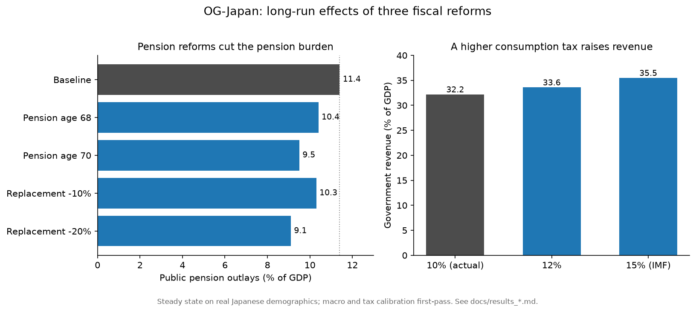

# OG-Japan (OG-JPN)

| | |
| --- | --- |
| Org | [](https://pslmodels.github.io/OG-Core/) [](LICENSE) [](https://arihantlodha-cmd.github.io/OG-JPN/) |
| Package | [](https://www.python.org/downloads/) [](https://www.python.org/downloads/) [](https://github.com/astral-sh/ruff) |
| Testing |    |

**Documentation: https://arihantlodha-cmd.github.io/OG-JPN/**

An overlapping-generations model of Japanese fiscal policy, built on
[OG-Core](https://github.com/PSLmodels/OG-Core). OG-JPN is a country
calibration of OG-Core, in the same family as OG-USA, OG-UK, OG-BRA, and
OG-THA. To our knowledge it is the first open-source OG model of Japan.

Japan is an unusually important case for this class of model: it has the
oldest population of any large economy and a gross public debt of roughly
215 percent of GDP, beyond what OG-Core's default parameter range even
anticipated. Those are exactly the fiscal-demographic dynamics
overlapping-generations models are built to study.


## What it does

The model is calibrated to Japanese data and solved end to end:

- **Demographics**: UN World Population Prospects (country code 392):
  fertility, mortality, and the population by age.
- **Income tax**: a progressive schedule fitted to the National Tax
  Agency's 2023 salary-bracket tax data (effective rates from about 2
  percent at the bottom to 40 percent at the top).
- **Pensions**: Japan's two-tier public pension (flat basic pension plus
  the earnings-related employees' pension), with the model anchored to yen.
- **Fiscal side**: gross debt 215 percent of GDP (IMF), the capital share
  from the Penn World Table, statutory social insurance, capital,
  corporate, and consumption tax rates.
- **Initial wealth**: households start the transition with Japan's
  observed wealth-by-age profile (2019 national survey).
- The model solves a **steady state** and a full **transition path** (the
  economy's year-by-year journey as the population ages).

Nothing was tuned to hit it, but the model's public pension bill in its
first year is **10.2 percent of GDP, against 10.4 percent in Japan**
(MHLW, FY2022), and it rises about two points over the next two decades as
the population ages. Tax revenue is 33.3 percent of GDP against 34.4
(OECD). See the **[validation chapter](https://arihantlodha-cmd.github.io/OG-JPN/content/calibration/validation.html)**
for what matches, what does not yet, and why.

## Policy results

Three fiscal reforms Japan is actually debating, each solved both as a
long-run steady-state comparison and on the transition path, on real
Japanese demographics:

| Reform | Long-run effect |
|---|---|
| [Consumption tax 10 to 12 and 15 percent](docs/results_consumption_tax.md) | tax revenue up 1.3 and 3.2 points of GDP; consumption down, labor slightly up |
| [Pension age 65 to 68 and 70](docs/results_retirement_age.md) | long-run pension bill from 12.1 to 10.9 and 10.0 percent of GDP; labor up |
| [Replacement-rate cut 10 and 20 percent](docs/results_replacement_rate.md) | long-run pension bill from 12.1 to 10.9 and 9.7 percent of GDP; labor up |



The transition versions (the `*_tpi.md` docs) add the year-by-year path
and the net present value of each change. They also show capital rising
along the transition (close to 10 percent by year 20 under the 15 percent
consumption tax). That comes mainly from debt: for its first 20 years
OG-Core holds government purchases at a fixed share of GDP, so each
reform's budget gain pays down debt, which frees saving for private
capital. Once the debt rule restores debt to target, capital returns to
close to its baseline level. Each result page measures this channel from
the solved paths.

## Contributions upstream

Building OG-JPN surfaced improvements to OG-Core itself, contributed back:

- **npv_table** ([PR #1195](https://github.com/PSLmodels/OG-Core/pull/1195),
  merged): a table of the net present value of a reform's flow-variable
  changes, which OG-JPN uses to report the transition results.
- **Custom initial wealth distribution**
  ([PR #1209](https://github.com/PSLmodels/OG-Core/pull/1209), superseded by
  the maintainers' [#1254](https://github.com/PSLmodels/OG-Core/pull/1254),
  merged): lets a country model supply an observed initial wealth
  distribution instead of the steady-state one. OG-JPN feeds it Japan's
  survey wealth-by-age profile (`ogjpn/wealth.py`).
- **Japan in the shared demographic data**
  ([EAPD-DRB/Population-Data #14](https://github.com/EAPD-DRB/Population-Data/pull/14),
  merged) and in OG-Core's `country_dict`
  ([PR #1196](https://github.com/PSLmodels/OG-Core/pull/1196)), so Japan runs
  offline like the other supported countries.
- **Resource-constraint failure diagnostics**
  ([PR #1213](https://github.com/PSLmodels/OG-Core/pull/1213), merged): the transition
  solver now reports the size and location of a resource-constraint failure
  so a boundary artifact can be told from a real calibration problem.
- **Population freeze before convergence**
  ([issue #1290](https://github.com/PSLmodels/OG-Core/issues/1290),
  [PR #1293](https://github.com/PSLmodels/OG-Core/pull/1293)): OG-Core fixes
  the population at period 1.5 * S; for Japan and Korea it has not converged
  by then, which causes a resource-constraint error at t = 120. The PR lets a
  country model choose a later period.
- **Silent household solver failures**
  ([PR #1294](https://github.com/PSLmodels/OG-Core/pull/1294)): with the
  sparse FOC Jacobian, a household solve that stopped without converging was
  never retried with dense finite differences, leaving large Euler errors
  for a few cohorts with no warning. Found by checking OG-JPN's transitions.
- **Non-dollar currency anchor**
  ([PR #1292](https://github.com/PSLmodels/OG-Core/pull/1292)): lifts the cap
  on the initial guess for the currency factor so a model can be anchored to
  yen.

## Honest limitations

- The income tax uses a single average effective rate rather than Japan's
  full progressive schedule; sharpening it needs the income distribution
  behind the published rates.
- The transition satisfies the resource constraint to below 1e-6 everywhere
  except two single periods, both of which cancel in reform-minus-baseline
  results. **t = 2** (initial condition): starting from Japan's observed
  wealth-by-age profile (`ogjpn/wealth.py`) instead of OG-Core's
  steady-state proxy cut it from 1.8e-3 to 1.2e-3; the rest has another
  source, still being traced. **t = 120** (~1.2e-3): OG-Core freezes the
  population at period `1.5 * S` even though Japan's age mix is still
  moving, so population growth jumps there.
- The income anchor (`mean_income_data`) is still OG-Core's US default, so
  currency-denominated output is not yet in yen (see docs/NEXT_STEPS.md).

## Layout

```
ogjpn/
  calibrate.py     assembles macro + tax + demographics into OG-Core
  macro_params.py  debt, growth, capital share, spending shares (sourced)
  tax_params.py    income, social insurance, capital, corporate, consumption taxes
  wealth.py        Japan's initial wealth-by-age distribution (2019 survey)
  constants.py     country code (392) and metadata
examples/          steady state, transition, and the three reform analyses
scripts/           data fetch and figure scripts
tests/             calibration tests (no network, no solve)
docs/
  book/            the Jupyter Book documentation site
  results_*.md     the policy write-ups (also included in the docs site)
  METHODOLOGY.md, NEXT_STEPS.md   working notes
```

## Running

Install OG-Core and this package into the same environment:

```
git clone https://github.com/arihantlodha-cmd/OG-JPN.git
cd OG-JPN
uv sync --extra dev        # or: pip install -e ".[dev]"
```

This pulls OG-Core (0.24.6 or later) from PyPI.

Then:

```
python examples/run_ogjpn_ss.py    # steady state + validation
python examples/run_ogjpn_tpi.py   # baseline transition
python -m pytest tests/            # calibration tests
```

Japan's demographics come from the UN World Population Prospects (country
code 392). Japan is in OG-Core's offline data mirror
([EAPD-DRB/Population-Data](https://github.com/EAPD-DRB/Population-Data),
added by OG-JPN in PR #14), so the model runs without a UN API token. A
free UN Data Portal token, saved as `~/.config/og/un_api_token.txt`, pulls
the live data instead.

## Roadmap

See the [roadmap](https://arihantlodha-cmd.github.io/OG-JPN/content/roadmap.html)
in the documentation.
